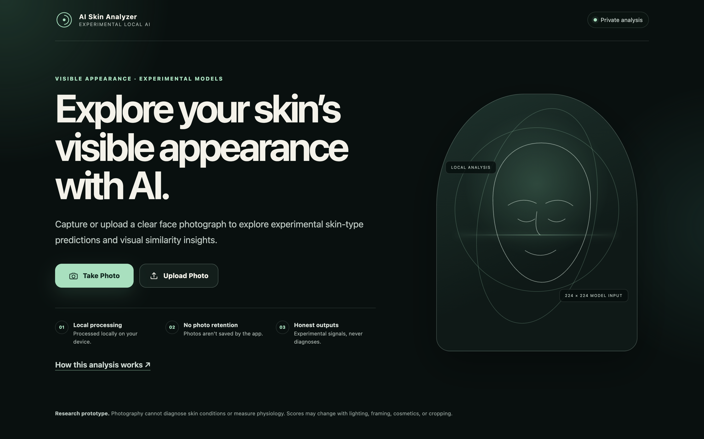
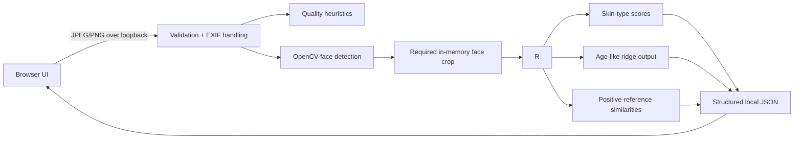

# AI Skin Analyzer 2.0




*The application landing page. No private facial photographs or model predictions are shown.*


A polished, local-first computer-vision application for exploring experimental facial-skin image signals. It combines camera capture, secure upload handling, automatic single-face cropping, deterministic photo-quality feedback, and four honestly described fitted components in one responsive browser experience.

> **Research prototype—not a medical device.** The application does not diagnose acne, detect dark circles, measure skin physiology, establish a person's age, or recommend treatment or products.

## What the application does

- Captures a photograph through the browser camera or accepts a local JPEG/PNG upload.
- Processes the image on a Python server bound to `127.0.0.1`; no external inference API or analytics service is used.
- Validates file content, dimensions, EXIF orientation, and pixel count before decoding.
- Reports transparent blur, brightness, resolution, face-count, and face-size heuristics.
- Automatically requires one detected face, creates an in-memory facial crop, and analyzes that crop once.
- Displays actual model scores without presenting them as calibrated confidence.
- Keeps uploaded and captured images in memory and does not save them by default.
- Supports keyboard navigation, visible focus, screen-reader status updates, reduced motion, and responsive layouts.

The primary flow is:

```text
Welcome → Camera or Upload → Automatic face crop and local analysis → Results
```

The interface contains no bundled face photograph or example prediction. This is intentional: no privacy-reviewed image fixture or redistribution-cleared model artifact is included in the source-only portfolio package.

## Output meanings

| Component | Application output | What it does **not** mean |
|---|---|---|
| Skin type | ResNet50 softmax scores for provisional `Dry`, `Normal`, and `Oily` image classes | Calibrated confidence, measured sebum/hydration, or validated physiological skin type |
| Age-like regression | Estimate of an unresolved historical numeric dataset label | Chronological age, biological age, or medically validated “skin age” |
| Acne reference | Cosine similarity to fitted positive-reference embeddings | Acne presence/absence, probability, severity, or diagnosis |
| Dark-circle reference | Cosine similarity to fitted positive-reference embeddings | Dark-circle presence/absence, probability, severity, or diagnosis |

Missing negatives in the historical acne and dark-circle labels make binary detection claims invalid. The application deliberately preserves these outputs as similarity values.

## Exploratory model background

The private fitted artifacts are not part of the public source package. In the private development workspace:

- the Phase 6K skin-type model recorded approximately **78.90% accuracy on 109 repeatedly examined development images**;
- the Phase 6L age-like component recorded **5.136 MAE in provisional label units**, versus a constant-mean baseline MAE of **6.553**;
- the positive-reference development coverage was approximately **96.0% for acne references** and **88.3% for dark-circle references**.

These are exploratory development results—not independent test performance, clinical accuracy, or evidence of real-world reliability. Trained artifacts remain private because underlying data rights and consent are unresolved.

## Architecture



See [application architecture](docs/APP_ARCHITECTURE.md), [model limitations](docs/MODEL_LIMITATIONS.md), and [local privacy model](docs/LOCAL_APP_PRIVACY.md).

## Project structure

```text
AI_Skin_Analyzer/
├── app/
│   ├── server.py                 # Token-protected localhost HTTP server
│   ├── config.py                 # Repository-relative configuration
│   ├── imaging/                  # Validation, face detection, quality checks
│   ├── inference/                # Artifact contract, model loader, pipeline
│   ├── templates/index.html      # Accessible product flow
│   └── static/                   # Local CSS and JavaScript modules
├── scripts/run_app.py            # Verified application entry point
├── skin_analyzer/                # Earlier validation/model-contract package
├── tests/                        # Synthetic and opt-in private integration tests
├── docs/                         # Architecture, setup, privacy, and model cards
├── reports/private/              # Private artifacts; ignored, never published
└── pyproject.toml
```

Legacy notebooks, scripts, datasets, labels, private reports, models, feature stores, and local face photographs are preserved but excluded by `.gitignore`.

## Verified environment

- macOS on Apple Silicon (`arm64`)
- Python 3.12.9
- TensorFlow 2.16.2
- Keras 3.3.3
- NumPy 1.26.4
- OpenCV headless 4.10.0
- Pillow 10.4–13.x supported by the application metadata

The working environment is maintained outside the Desktop project directory. Do not recreate the old project-local `.venv`.

## Run locally on macOS

Activate the existing environment and enter the project directory:

```bash
source ~/Developer/venvs/ai-skin-analyzer/bin/activate
cd /path/to/AI_Skin_Analyzer
```

Verify private artifacts without loading TensorFlow:

```bash
python scripts/run_app.py --check
```

Start the application:

```bash
python scripts/run_app.py
```

The server prints a private, tokenized `http://127.0.0.1:<port>/` URL and opens it in the default browser. Use `--no-open` to prevent automatic browser launch or `--port 8765` to request a specific loopback port.

Camera access starts only after the user selects **Take Photo**. Chrome and Safari treat loopback origins as local secure contexts, but camera behavior still depends on browser and macOS permissions. A phone cannot access the Mac application through the phone's own `127.0.0.1`.

### Dependency installation

No package installation is needed in the verified environment. For a new, explicitly approved environment, dependency resolution can use:

```bash
python -m pip install -e '.[ml,app,dev]'
```

Do not indiscriminately upgrade TensorFlow, Keras, or NumPy. Model compatibility is verified against the versions above.

## Tests

Run the source-only synthetic suite:

```bash
python -m pytest -p no:cacheprovider
```

Run the private model-loading and Phase 6N regression check only in the private workspace where artifacts are present:

```bash
AI_SKIN_RUN_PRIVATE_INTEGRATION=1 python -m pytest -p no:cacheprovider tests/test_app_inference.py
```

Tests generate images in memory or temporary directories. They do not open the legacy facial dataset. The private integration test loads the fitted artifacts and runs a synthetic solid-color image to verify class ordering, preprocessing, and numerical compatibility.

## Security and privacy design

- Loopback binding only: `127.0.0.1`.
- Random per-process token required for the application page and API.
- Same-origin and request-token checks on local POST endpoints.
- Strict JPEG/PNG signature, MIME, byte, pixel-count, and decode validation.
- No arbitrary file paths accepted from browser requests.
- No image bytes, filenames, query tokens, or exception traces in HTTP logs.
- `Cache-Control: no-store`, restrictive CSP, frame denial, MIME sniffing protection, no-referrer policy, and camera-only Permissions Policy.
- Browser object URLs are revoked and camera tracks are stopped during navigation and unload.
- Raw photos and generated crops are not written to disk by application code.

“Local” means the browser transmits the photo to a Python process on the same Mac. It does not mean the image never leaves browser memory. See [privacy documentation](docs/LOCAL_APP_PRIVACY.md).

## Known limitations

- The source dataset's permissions, consent scope, annotation provenance, and subject grouping remain unresolved.
- Exact and possible derivative leakage affected historical development work; no independent final validation is claimed.
- The classic OpenCV frontal-face detector can miss faces or detect nonfaces. Missing or multiple detected faces stop analysis rather than silently choosing a person or falling back to the original image.
- Blur and brightness checks use transparent thresholds, not scientifically validated photographic grading.
- Automatic face cropping changes the fitted input distribution because the models were developed largely with full-image preprocessing. It is explicitly experimental and is not claimed to improve accuracy.
- Camera capture has not been claimed for browsers or devices outside the tested local macOS context.
- Model artifacts and positive-reference embeddings are intentionally not distributable with the source repository.

Read [MODEL_LIMITATIONS.md](docs/MODEL_LIMITATIONS.md) before interpreting any result.

## Portfolio release policy

Publish source code, synthetic tests, schemas, and documentation only. Do not publish facial images or original filenames; datasets, labels, manifests, or review records; trained checkpoints or fitted embeddings; private metrics/provenance files; session URLs or local tokens; or screenshots containing participant or user images.

The release scanner is a screening aid—not legal or privacy approval:

```bash
python -m skin_analyzer.release_safety --root .
```

This working directory is expected to fail a whole-tree release scan because it intentionally preserves private data and models. Build and review a source-only manifest instead. No Git repository is initialized or published automatically.

## Future work

- Complete dataset eligibility and genuine-negative annotation gates.
- Establish reliable subject/group-disjoint evaluation.
- Validate a privacy-cleared replacement dataset and independent final holdout.
- Calibrate model scores only after suitable validation data exists.
- Replace Haar-cascade detection only after evaluating a local, redistribution-cleared alternative.
- Add automated cross-browser camera tests without collecting real user imagery.

## Hosted deployment (optional)

A public Vercel frontend with a separate private-model Railway inference service is documented in [Hosted deployment](docs/HOSTED_DEPLOYMENT.md). This mode sends photos to a remote server and has different privacy implications than the localhost application; it requires securely provisioning privately held model weights. The public source repository does not include model artifacts.
