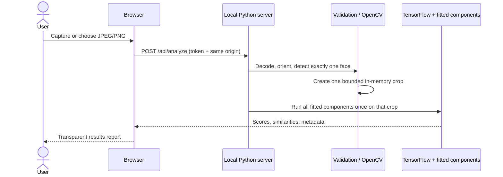

# AI Skin Analyzer 2.0 application architecture

## System boundary

The application is a local browser client plus a Python process bound to `127.0.0.1`. The browser uses standard camera and file APIs. Image bytes are posted only to the loopback server and remain in process memory. There is no cloud inference, database, analytics client, or external asset dependency.

## Components

### HTTP boundary

`app/server.py` uses Python's `ThreadingHTTPServer` to avoid a new web-framework dependency. It binds only to loopback, loads model artifacts once, generates a random session token, suppresses request logging, validates host/origin/token, and serves an allowlisted set of static assets. Browser requests cannot name filesystem paths.

### Image boundary

`app/imaging/validation.py` checks byte length, MIME type, JPEG/PNG signatures, decoded format, dimensions, and pixel count. EXIF orientation is applied in memory. Images that do not require orientation correction retain their original bytes for Phase 6N preprocessing parity.

`app/imaging/face_detection.py` runs the packaged OpenCV Haar cascade locally. It returns zero, one, or multiple boxes. Analysis requires exactly one detected face; the app never chooses a person from an ambiguous multi-face image and never falls back to full-image inference. The bounded crop retains facial context and is encoded as an in-memory PNG.

`app/imaging/quality.py` reports deterministic resolution, brightness, blur, face-count, and face-size indicators. These are capture guidance, not clinical quality measures.

### Inference boundary

`app/inference/artifacts.py` validates run names, regular files, artifact hashes, private provenance hashes, array keys/shapes, class order, and preprocessing metadata. NumPy archives are loaded with `allow_pickle=False`.

`app/inference/models.py` loads the Keras checkpoint with `compile=False` and `safe_mode=True`, locates the pooled ResNet50 backbone, and preserves the Phase 6N pipeline:

1. TensorFlow decodes three-channel RGB input.
2. Pixels are cast to `float32` and resized to 224×224.
3. `tf.keras.applications.resnet50.preprocess_input` applies caffe-mode ImageNet preprocessing.
4. The classifier returns scores ordered `Dry`, `Normal`, `Oily`.
5. The pooled 2,048-dimensional embedding feeds the age-like ridge component and cosine positive-reference components.

A process-wide lock serializes TensorFlow inference. Model objects load once per process.

### Browser modules

- `camera.js` owns permission, device selection, mirroring, capture, and track cleanup.
- `api.js` owns tokenized same-origin requests and timeouts.
- `app.js` owns product state and navigation.
- `results.js` renders model values with DOM text nodes rather than HTML injection.
- `styles.css` supplies the responsive design system without remote fonts or a build step.

## Automatic crop-only contract

`POST /api/analyze` accepts one JPEG or PNG body and no processing-mode parameter. Validation, EXIF orientation, face detection, cropping, quality heuristics, and one predictor call occur in the same request. The skin-type, age-like, acne-reference, and dark-circle-reference outputs therefore come from the same cropped representation. The response includes a preview generated from that exact crop.

This mandatory crop is an experimental input-distribution change: the fitted models were developed largely with full-image preprocessing. It is a product simplification, not evidence of improved accuracy.

## Failure behavior

Invalid files and obsolete processing parameters return controlled 4xx JSON errors. Unexpected failures return a generic 500 message and no traceback. Missing or ambiguous faces stop analysis with a recovery message; no model inference occurs and the user can retake or upload another photo.
